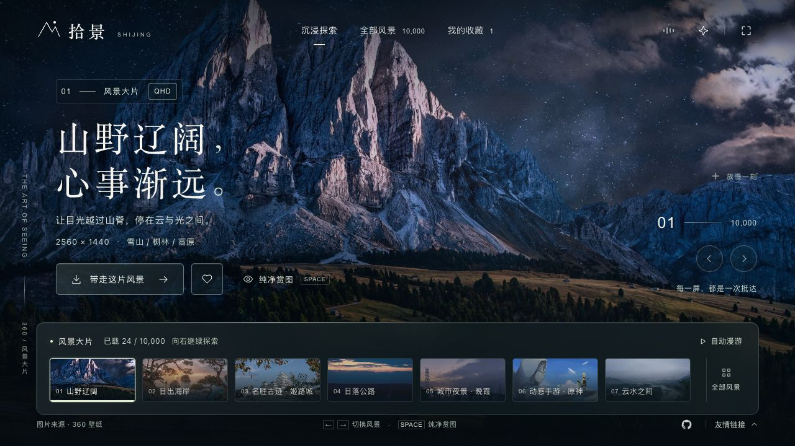

# Stillscape · 拾景

以风景为中心的沉浸式壁纸浏览网站。

Stillscape 将全屏影像、缓动转场与柔和光影结合，提供分类浏览、连续探索、壁纸下载、本地收藏和可选背景音乐。项目使用原生 HTML、CSS 与 JavaScript 构建界面，通过轻量 Node.js 服务接入第三方图库，无数据库和账号系统。



## 功能特性

- **沉浸浏览**：全屏风景、镜头缓动、指针光影、纯净赏图与自动漫游。
- **多来源图库**：接入 360 壁纸分类及 Bing 每日图片，支持分页浏览与接近末尾自动续载。
- **稳定加载**：等高骨架屏、缩略图预览、高清图淡入；续载保留当前选择、键盘焦点及滚动位置。
- **下载与收藏**：提供来源原图和适配分辨率下载；收藏保存在当前浏览器。
- **轻音乐**：默认关闭，用户点击后加载；支持循环播放、暂停续播及音量淡入淡出。
- **多端操作**：适配桌面与手机，支持键盘快捷键，并遵循系统“减少动态效果”设置。

## 快速开始

需要 **Node.js 22 或更高版本**。直接运行源码无需安装第三方运行时依赖。

```sh
git clone https://github.com/zcjunblog/stillscape.git
cd stillscape
npm start
```

访问 [http://127.0.0.1:4178](http://127.0.0.1:4178)。

开发、测试与生产构建：

```sh
npm ci
npm test
npm run build
npm run preview
```

| 命令 | 说明 |
| --- | --- |
| `npm start` | 运行源码版本；前端修改后刷新即可，服务端修改后需重启 |
| `npm test` | 执行 API、缓存、下载、分页、加载状态及音乐等自动化测试 |
| `npm run build` | 生成压缩、资源指纹和 Brotli/Gzip 文件 |
| `npm run preview` | 运行 `dist/shijing/` 中的生产构建 |

仓库中的 GitHub Actions 工作流会在推送和 Pull Request 时执行测试与构建。

## 部署

推荐先构建，再部署生成的 `dist/shijing/` 目录。该目录包含运行所需的前端资源与 Node.js 服务文件，无需安装生产依赖。

```sh
npm ci
npm run build
cd dist/shijing
HOST=0.0.0.0 PORT=4178 node server.mjs
```

使用进程管理工具维持服务运行，并在前方配置域名、HTTPS 与反向代理。默认监听地址为 `127.0.0.1`，可通过 `HOST` 和 `PORT` 调整。

**本项目需要 Node.js 服务，不能仅部署到 GitHub Pages 等纯静态托管平台。** 服务端负责第三方 API 转发、缓存、数据标准化与下载校验；前端与 API 使用同一来源。

## 项目结构

```text
.
├── index.html              # 页面结构与 SVG 图标
├── style.css               # 视觉、响应式布局与动效
├── app.js                  # 浏览、收藏、预加载和音乐交互
├── api.mjs                 # 图库适配、数据缓存与下载代理
├── server.mjs              # HTTP 服务、压缩与静态资源缓存
├── build.mjs               # 生产构建
├── assets/                 # 加载背景与可选背景音乐
├── docs/preview.png        # 界面预览
├── test/                   # 自动化测试
├── THIRD_PARTY.md          # 第三方来源与素材声明
└── LICENSE                 # 应用代码的 MIT 许可证
```

## 接口与数据说明

以下路径由本项目的 Node.js 服务提供：

| 路径 | 用途 |
| --- | --- |
| `/api/categories` | 获取 360 壁纸分类，缓存 1 小时 |
| `/api/wallpapers?category=9&start=0&count=24` | 按分类分页，每次最多 48 张，缓存 5 分钟 |
| `/api/bing?start=0&count=8` | 获取 Bing 近期每日图片，缓存 15 分钟 |
| `/api/download?url=...&size=original` | 下载来源原图或适配尺寸，仅接受允许的图片来源 |

首页首批加载 24 张，继续浏览会自动请求后续页面。360 图库内容及更新频率取决于上游；Bing 当前最多浏览近期 15 天。搜索仅筛选当前已加载图片。

本项目使用第三方可访问接口，接口稳定性、内容数量与持续可用性由上游决定。项目不提供壁纸内容授权，也不保证第三方接口具有服务等级承诺。

## 性能与本地数据

- 生产构建压缩 HTML 引用的 JS/CSS，并为静态资源生成内容指纹及 Brotli/Gzip 文件；HTML 重新验证，带指纹资源可长期缓存。
- 分类和图库页面元数据使用有期限的浏览器本地缓存，最多保留 12 条记录；缓存损坏或存储不可用时仍可继续浏览。
- 复用最近解码的图片，顺序预加载相邻风景，并在指针停留或键盘聚焦时准备目标图片；开启省流模式或慢速网络时减少自动预取。
- 未准备好的大图优先呈现可用缩略图，再淡入高清图；骨架屏在首次绘制时预留缩略图位置。
- 背景音乐约 7 MB，仅在点击开关后请求，支持音频字节范围加载。

收藏与图库元数据保存在当前浏览器，不提供跨设备同步。图片显示与下载会访问第三方来源；本地缓存不代表图库可以完整离线使用。公网首屏速度取决于部署环境、网络及来源 CDN。

## 项目参考与致谢

### 图库接口参考

本项目参考了 [mengkunsoft/wallpaper](https://github.com/mengkunsoft/wallpaper) 对 **360 壁纸分类、分类分页接口及 Bing 每日图片接口的使用方式**，感谢原作者对接口调用思路的整理与公开分享。具体参考可见其 [API 实现](https://github.com/mengkunsoft/wallpaper/blob/master/api/index.php)。

Stillscape 的页面布局、视觉样式、动画、交互与 Node.js 服务由本项目独立实现。参考项目的版权与其自身的使用要求归原作者所有，本仓库的 MIT 许可证不适用于参考项目。

### 自有设计 Skill

网站的视觉设计、Motion 动效、光影效果和界面打磨使用作者自有的 **「官网设计」Skill（`guanwang`，本项目早期以 `website-ui-craft` 名称使用）**，配合 Codex 完成设计与开发。

该 Skill 计划作为独立项目发布到 GitHub。**当前尚未提供公开仓库链接，开源后会在本节补充正式地址。** Skill 本体未包含在本仓库中，其后续许可与文档以独立仓库为准。

<!-- SKILL_REPOSITORY_URL: TODO — 官网设计 Skill 开源后，在此补充正式 GitHub 链接。 -->

## 自定义

- **默认分类、文案与交互**：修改 `app.js`；布局与视觉样式位于 `index.html`、`style.css`。
- **背景音乐**：替换 `assets/ambient-music.mp3`，更新 [第三方素材声明](THIRD_PARTY.md)，重新构建。更换文件名时同步修改 `app.js` 与 `build.mjs`。
- **友情链接**：在 `index.html` 的 `#friend-links .friend-panel` 中追加 `.friend-entry` 链接。默认包含 [简约导航](https://nav.gs/) 和 [关于我们](https://jkhcz.com/)。

## 版权与许可

Copyright © 2026 [zcjunblog](https://github.com/zcjunblog)。应用代码与项目原创文档采用 [MIT License](LICENSE)；复制、修改或分发时请保留许可证要求的版权及许可声明。

**MIT 许可证不覆盖壁纸、摄影、背景音乐、预览截图中的第三方影像以及第三方名称或标识。** 这些内容的权利归各自权利人所有，下载或展示不构成额外的使用授权。

仓库中的音乐来自项目维护者指定的外部地址，目前未核实曲名、作者及独立的再分发许可，本项目不将其声明为原创或免版权音乐。使用、再分发或商用第三方素材前，请确认相应权利与许可。详细来源、文件范围及处理方式见 [THIRD_PARTY.md](THIRD_PARTY.md)。

如权利人对本项目展示或包含的素材有异议，可通过 [GitHub Issues](https://github.com/zcjunblog/stillscape/issues) 联系维护者，并提供相关文件、来源与权属信息，以便核实并移除或替换。请勿在公开 Issue 中提交私人证明材料。

## 反馈与贡献

欢迎通过 [Issues](https://github.com/zcjunblog/stillscape/issues) 报告问题，或提交 Pull Request。反馈界面问题时，请尽量提供浏览器、设备尺寸、复现步骤及截图；提交代码前请运行 `npm test` 与 `npm run build`。
