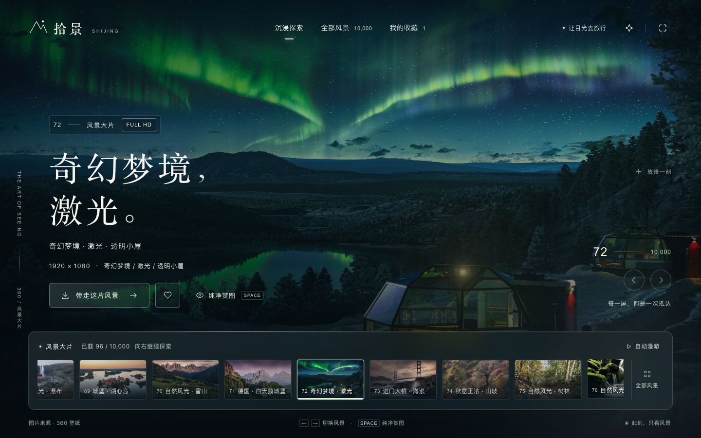
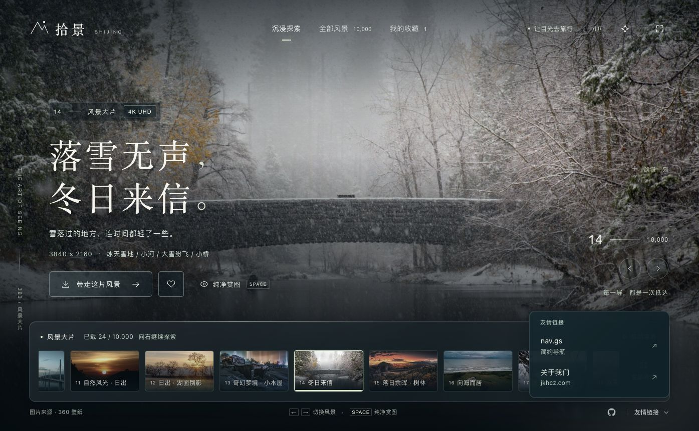

<div align="center">

# Stillscape · 拾景

**每一屏，都是一次抵达。**

一个以风景为中心的沉浸式壁纸画廊。<br>全屏影像、轻柔动效与背景音乐，让浏览成为一段安静的漫游。

[](LICENSE) [](https://www.php.net/) [](package.json) [](https://nodejs.org/) [](https://github.com/zcjunblog/stillscape/actions/workflows/ci.yml)

[在线体验](https://xss6.com/stillscape/) · [下载部署包](https://github.com/zcjunblog/stillscape/releases/latest) · [三步部署](#三步部署) · [开发文档](#开发与构建) · [反馈问题](https://github.com/zcjunblog/stillscape/issues)

</div>

<p align="center">
  <a href="https://xss6.com/stillscape/">
    
  </a>
</p>
<p align="center"><sub>极光之下，留一刻给风景。点击画面进入在线演示。</sub></p>

## 关于拾景

Stillscape 将壁纸浏览、收藏与下载融入同一个全屏界面。风景是画面的主体，操作停留在视线边缘；从缩略图探索到高清图呈现，以连续转场连接每一次选择。

项目采用原生 HTML、CSS 与 JavaScript，无前端框架运行时依赖。提供 **PHP 直接上传版**与可选的 Node.js 运行版，无需数据库或账号系统，适合部署在个人网站的独立目录。

## 体验与功能

| 能力 | 细节 |
| --- | --- |
| **沉浸浏览** | 全屏影像、镜头缓动与指针光影；支持纯净赏图和自动漫游 |
| **分类探索** | 360 壁纸分类与 Bing 每日图片，接近列表末尾自动加载下一批 |
| **平稳切换** | 等高骨架屏、相邻图片预加载、缩略图到高清图淡入；续载保留当前选择 |
| **下载与收藏** | 来源原图与适配分辨率下载，本地收藏，以及已加载图片搜索 |
| **轻音乐** | 默认关闭，点击后加载；支持循环、暂停续播与音量淡入淡出 |
| **多端适配** | 桌面与手机布局、键盘操作，并遵循系统“减少动态效果”设置 |

<p align="center">
  
</p>
<p align="center"><sub>冬日来信 · 全屏浏览与风景胶片</sub></p>

## 三步部署

**支持 PHP 和 Node.js 两种运行方式，选择其中一种即可。** [Releases](https://github.com/zcjunblog/stillscape/releases/latest) 提供已构建的部署包，下载后无需在服务器安装构建依赖或重新编译。

| 部署版本 | 服务器要求 | 下载与使用 |
| --- | --- | --- |
| **PHP 直接上传版** | PHP 8.1+、cURL、可用的 HTTPS CA 证书 | [stillscape-php.zip](https://github.com/zcjunblog/stillscape/releases/latest/download/stillscape-php.zip)，上传到网站目录，无需 Node.js 服务 |
| **Node.js 运行版** | Node.js 22+，能保持进程运行 | [stillscape-node.zip](https://github.com/zcjunblog/stillscape/releases/latest/download/stillscape-node.zip)，解压后启动服务，无需 PHP |

### PHP 版

1. **开启 PHP**：为网站选择 PHP 8.1+ 并启用 cURL。宝塔用户检查“网站 → PHP 版本”，不能保持“纯静态”。
2. **上传文件**：解压 `stillscape-php.zip`，将内部 `stillscape/` 文件夹里的**全部内容**上传到网站根目录或任意子目录，保持文件结构。
3. **打开网站**：根目录部署访问 `https://你的域名/`；子目录部署则访问对应地址，例如 `https://你的域名/wallpaper/`。该目录应直接包含 `index.html`、`assets/` 和 `api/`。

### Node.js 版

1. **解压文件**：下载 `stillscape-node.zip`，在装有 Node.js 22+ 的服务器上解压，进入内部 `stillscape/` 目录。
2. **启动服务**：执行 `HOST=127.0.0.1 PORT=4178 node server.mjs`，通过宝塔 Node 项目、PM2 或已有进程管理工具保持运行，无需执行 `npm install`。
3. **绑定域名**：将域名根路径或自选子目录反向代理到 `127.0.0.1:4178`；子目录代理需移除路径前缀，参见包内 `DEPLOY.md` 的示例。

**两种版本均无需数据库。** PHP 版无需常驻 Node.js 服务，Node.js 版无需 PHP 环境。部署目录名称不受限制；[在线演示](https://xss6.com/stillscape/) 使用的 `/stillscape/` 仅为示例。

每个部署包均附 `DEPLOY.md` 和素材许可说明，[SHA256SUMS.txt](https://github.com/zcjunblog/stillscape/releases/latest/download/SHA256SUMS.txt) 用于核对下载文件。GitHub 自动生成的 **Source code** 是源码归档，开发或自行构建时使用；直接部署请选择上表中对应的 ZIP。

详细排查见 [PHP 部署说明](deploy/php.md) 与 [Node.js 部署说明](deploy/README.md)。

## 开发与构建

```sh
git clone https://github.com/zcjunblog/stillscape.git
cd stillscape
npm ci
npm start
```

本地开发地址：[http://127.0.0.1:4178](http://127.0.0.1:4178)。运行完整测试还需要 PHP 8.1+ 与 cURL。

| 命令 | 用途 |
| --- | --- |
| `npm start` | 启动 Node.js 开发服务 |
| `npm test` | 执行 Node.js / PHP API、缓存、下载、分页及交互测试 |
| `npm run build:php` | 输出 PHP 直接上传版至 `dist/php-img/` |
| `npm run build` | 输出 Node.js 运行版至 `dist/shijing/` |
| `npm run preview` | 预览 Node.js 生产构建 |

GitHub Actions 在推送和 Pull Request 时执行测试及两种构建。

<details>
<summary><strong>项目结构、接口与自定义</strong></summary>

### 项目结构

```text
stillscape/
├── index.html       # 页面结构与 SVG 图标
├── style.css        # 视觉、响应式布局与动效
├── app.js           # 浏览、收藏、预加载与音乐交互
├── php/             # PHP API 入口与图库适配器
├── api.mjs          # Node.js API 适配器
├── server.mjs       # Node.js HTTP 服务
├── build.mjs        # 压缩、资源指纹与生产构建
├── assets/          # 加载背景与可选背景音乐
├── docs/            # 界面演示图片
├── deploy/          # 部署与故障排查说明
└── test/            # 自动化测试
```

### 接口

PHP 版本使用 `api/index.php?route=...`，Node.js 版本使用 `/api/...`，两者的数据格式一致。

| PHP 路由参数 | Node.js 路径 | 用途 |
| --- | --- | --- |
| `route=categories` | `/api/categories` | 获取壁纸分类 |
| `route=wallpapers&category=9&start=0&count=24` | `/api/wallpapers?category=9&start=0&count=24` | 分类分页，每次最多 48 张 |
| `route=bing&start=0&count=8` | `/api/bing?start=0&count=8` | Bing 近期每日图片 |
| `route=download&url=...&size=original` | `/api/download?url=...&size=original` | 校验图片来源并提供下载 |

### 自定义

- **文案与交互**：修改 `app.js`；布局与样式位于 `index.html`、`style.css`。
- **背景音乐**：替换 `assets/ambient-music.mp3` 后重新构建，并更新 [素材声明](THIRD_PARTY.md)；更改文件名时同步修改 `app.js` 和 `build.mjs`。
- **友情链接**：在 `index.html` 的 `#friend-links .friend-panel` 中追加 `.friend-entry` 链接。

</details>

## 性能与数据边界

发布构建包含压缩后的 JS/CSS、内容指纹和 Brotli/Gzip 文件。分类与页面元数据使用有限期缓存，图片按需加载并复用最近的解码结果；音乐仅在用户点击后请求。PHP 版本的静态资源缓存、压缩与音频 Range 由现有网站服务配置决定。

收藏保存在当前浏览器，不提供跨设备同步；搜索仅筛选已加载图片。首页首批加载 24 张并可继续分页，Bing 当前最多浏览近期 15 天。图库内容、更新频率和接口可用性取决于第三方来源，实际打开速度取决于部署环境、网络与图片 CDN。

## 项目参考与致谢

### 图库接口参考

感谢 [mengkunsoft/wallpaper](https://github.com/mengkunsoft/wallpaper) 对壁纸接口调用方式的公开整理。本项目参考其 [API 实现](https://github.com/mengkunsoft/wallpaper/blob/master/api/index.php) 中 **360 分类、分类分页与 Bing 每日图片接口的使用方式**。

Stillscape 的页面布局、视觉样式、动画交互及 Node.js / PHP 服务由本项目独立实现。参考项目的版权与使用要求归原作者所有，本仓库的 MIT 许可证不覆盖参考项目。

### 自有设计 Skill

网站的视觉设计、Motion 动效、光影效果与界面打磨，使用作者自有的 **「官网设计」Skill（`guanwang`，早期名称 `website-ui-craft`）**，配合 Codex 完成设计与开发。

该 Skill 计划独立开源，**正式发布后将在此补充 GitHub 链接**。Skill 本体未包含在本仓库中，其许可与使用文档以未来的独立仓库为准。

<!-- SKILL_REPOSITORY_URL: TODO — 官网设计 Skill 开源后，在此补充正式 GitHub 链接。 -->

## 版权与许可

Copyright © 2026 [zcjunblog](https://github.com/zcjunblog)。应用代码与原创文档采用 **[MIT License](LICENSE)**，复制、修改或分发时请保留相应版权与许可声明。

**摄影、壁纸、背景音乐及演示截图中的第三方影像不适用本项目的 MIT 许可**，相关权利归各自权利人所有。随仓库提供的音乐尚未核实曲名、作者及独立的再分发许可，不作为原创或免版权音频发布；使用、再分发或商用前，请核实授权或更换为已获授权的素材。完整来源见 [THIRD_PARTY.md](THIRD_PARTY.md)。

如权利人对素材使用有异议，请通过 [Issues](https://github.com/zcjunblog/stillscape/issues) 提供文件位置与来源说明，以便核实并移除或替换；请勿公开提交私人证明材料。

## 参与项目

欢迎提交 Issue 或 Pull Request。报告问题时，请附浏览器、设备尺寸、复现步骤及相关截图；提交代码前请运行 `npm test`、`npm run build` 和 `npm run build:php`。

<p align="center"><a href="https://xss6.com/stillscape/">进入拾景，去看下一片风景。</a></p>
